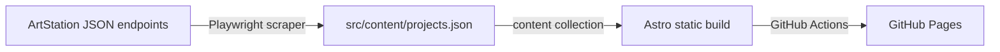

# JMR Showroom

A dark, editorial portfolio site for José Mercado Ruiz, a multidisciplinary designer working across print, 3D and motion. Live at [jmercadoruiz07.github.io/showroom](https://jmercadoruiz07.github.io/showroom).

The site is fully static, and its project data is scraped from the owner's [ArtStation](https://www.artstation.com/jmr_visuals) profile, so the portfolio is managed in one place and the site follows it.

## ✨ Highlights

- Full-window hero with a crossfading slideshow and oversized outlined wordmarks
- Filterable project gallery (masonry by album) with a hand-picked FEATURED accordion
- Project pages that mix images and Vimeo videos, with a lightbox that supports swipe on mobile
- Responsive from phone to wide desktop; respects `prefers-reduced-motion`
- Dark only, by design

## 🧱 Tech stack

- [Astro 7](https://astro.build) in static output mode
- React 19 islands for the interactive parts (hero carousel, gallery, lightbox); everything else is server-rendered Astro
- Content collections with a zod schema for the project data
- [Playwright](https://playwright.dev) for the ArtStation scraper
- GitHub Actions and GitHub Pages for deployment

## 🏗️ How it works



### ArtStation scraping

ArtStation is the single source of truth for the work. `bin/fetchPortfolio.js` drives a headless Chromium browser (Playwright) against ArtStation's public JSON endpoints and turns them into `src/content/projects.json`:

- Reads the user's custom albums and maps every project to the albums it belongs to
- Fetches the details of each project: title, date, tags, tools, description, images and Vimeo videos in their original order
- Retries flaky requests, and spaces them out to stay polite
- Applies small content conventions, such as a `2021 | ` prefix in a description setting the project's year
- Is all-or-nothing: if anything fails, the existing file is left untouched, so a partial scrape never ships

Refreshing the content is a manual GitHub Actions run. It scrapes, commits the updated `projects.json` and triggers a deploy.

### Static build

At build time Astro loads `projects.json` as a content collection, validates it, and generates the home page, the works page and one page per project. Images are served from ArtStation's CDN and nothing talks to a backend at runtime.

### Deployment

Pushing to `main` builds the site and publishes it to GitHub Pages.

## 🚀 Getting started

Requires Node 22.12 or newer.

```sh
npm install
npm run dev          # http://localhost:4321/showroom
npm run build        # production build to dist/
npm run preview      # serve the production build
npx astro check      # type check
```

To refresh the content from ArtStation locally:

```sh
npx playwright install chromium-headless-shell   # once
npm run fetch-portfolio
```

## 📁 Project structure

```text
bin/          ArtStation scraper
public/       Static assets (hero, about, favicon)
src/
  components/ Astro components and React islands
  content/    projects.json (generated)
  layouts/    Page shells
  pages/      Routes: home, works, project pages, about, 404
  styles/     Design tokens and base styles
  utils/      Small shared helpers
.github/      Deploy and content-refresh workflows
```

## 🤖 Working with agents

Implementation details, design-system rules and project conventions are in [AGENTS.md](./AGENTS.md).
